# Pemesanan Kendaraan — Tambang Nikel

Aplikasi web untuk memesan kendaraan perusahaan tambang nikel (1 kantor pusat, 1 kantor cabang, 6 tambang di 3 region) dan memantau pemakaian, konsumsi BBM, serta jadwal service kendaraan. Pegawai memesan lewat admin pool; setiap pemesanan harus disetujui atasan secara berjenjang sebelum kendaraan dipakai.

Dibuat sebagai technical test Fullstack Developer (Intern) dengan Laravel 13, Inertia.js 3, dan React.

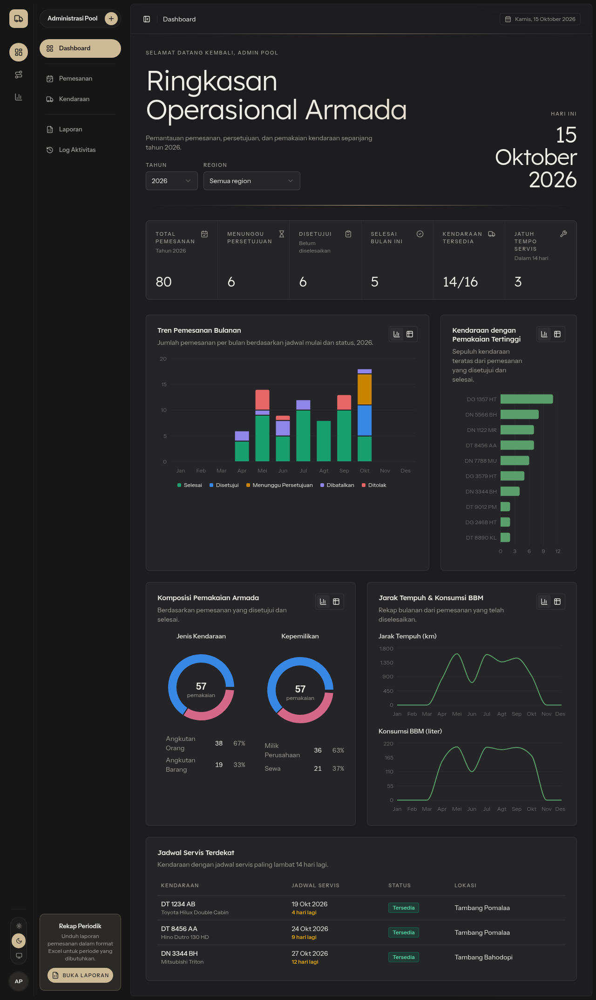

## Fitur

- **Dua role:** admin (pool) dan approver. Akun dibuat lewat seeder; registrasi publik tidak tersedia.
- **Pemesanan** dengan approver berjenjang 2–5 level. Kendaraan yang sedang perawatan dan driver nonaktif ditolak, dan jadwal yang bentrok dengan pemesanan lain ditolak dengan pesan yang menyebut kode booking yang bentrok. Kode otomatis `BK-YYYYMM-NNNNN`.
- **Persetujuan berjenjang:** inbox approver dengan tab _Menunggu Saya_, _Antrian_, dan _Riwayat_; setujui (catatan opsional) atau tolak (catatan wajib); badge jumlah approval yang menunggu di menu.
- **Pembatalan** dengan alasan, dan **penyelesaian** dengan odometer dan BBM yang sekaligus memperbarui odometer kendaraan.
- **Dashboard** admin dan approver dengan filter tahun dan region: pemesanan per bulan per status, 10 kendaraan paling sering dipakai, komposisi jenis/kepemilikan, jarak tempuh dan konsumsi BBM per bulan, serta kendaraan yang perlu service. Setiap grafik juga punya tampilan tabel.
- **Laporan periodik** dengan preset periode dan **export Excel** 2 sheet (_Pemesanan_ dan _Ringkasan_).
- **Log aktivitas** setiap proses: tersimpan di database dan di file log harian, dengan halaman pencarian dan dialog detail.
- **Kendaraan** (bonus): daftar dengan filter, serta detail berisi jadwal service, total km/BBM, dan riwayat pemakaian.
- **UI** berbahasa Indonesia, waktu WIB, responsif sampai lebar 375px, mode gelap mengikuti sistem, dan halaman error 403/404 berbahasa Indonesia.

## Versi

Diambil dari output perintah di lingkungan pengembangan pada 15 Oktober 2026:

| Komponen | Perintah                | Output                                                                         |
| -------- | ----------------------- | ------------------------------------------------------------------------------ |
| PHP      | `php -v`                | `PHP 8.5.10 (cli) (built: Sep  4 2026 15:58:22) (NTS)`                         |
| Laravel  | `php artisan --version` | `Laravel Framework 13.36.0`                                                    |
| MySQL    | `mysql --version`       | `mysql from 13.0.2-MariaDB, client 15.2 for Linux (x86_64) using readline 5.1` |
| Node.js  | `node -v`               | `v26.11.1`                                                                     |
| npm      | `npm -v`                | `12.2.0`                                                                       |

Server database yang tersedia di lingkungan ini adalah **MariaDB 13.0.2** (kompatibel MySQL). Seluruh migration, seeder, dan 173 test sudah dijalankan di MariaDB 13.0.2 maupun SQLite.

Library utama: Inertia.js 3 (`inertiajs/inertia-laravel` 3.5.1, `@inertiajs/react` 3.9.1), React 19.3, TypeScript 5.9, Tailwind CSS 4.3, shadcn/ui (Radix), Recharts 3.8, Laravel Wayfinder 0.1, `maatwebsite/excel` 4.0.4 (PhpSpreadsheet 5.10), dan Pest 5.3.

## Akun demo

Password semua akun: `password`.

| Email                  | Role     | Nama           | Jabatan                | Lokasi                 |
| ---------------------- | -------- | -------------- | ---------------------- | ---------------------- |
| `admin@nikel.test`     | Admin    | Admin Pool     | Staf Administrasi Pool | Kantor Pusat Kendari   |
| `approver1@nikel.test` | Approver | Budi Santoso   | Supervisor Pool        | Kantor Pusat Kendari   |
| `approver2@nikel.test` | Approver | Siti Rahmawati | Manager Operasional    | Kantor Pusat Kendari   |
| `approver3@nikel.test` | Approver | Andi Pratama   | Kepala Cabang          | Kantor Cabang Morowali |

## Instalasi

**Prasyarat**

- PHP ≥ 8.3 dengan ekstensi `pdo_mysql` (atau `pdo_sqlite`), `gd`, `zip`, `mbstring`, `xml`, `dom`, dan `fileinfo`. Ekstensi `gd` dan `zip` dibutuhkan PhpSpreadsheet untuk export Excel. Di Arch Linux: `sudo pacman -S php-gd`, lalu aktifkan `extension=gd` dan `extension=pdo_mysql` di `php.ini`; di Debian/Ubuntu: `sudo apt install php8.x-gd php8.x-zip php8.x-mysql`.
- Composer 2.
- Node.js 20.19+, 22.18+, atau 24.11+ (syarat Vite+) beserta npm.
- MySQL 8 atau MariaDB.

**Langkah**

1. Clone repository dan pasang dependency PHP:

    ```bash
    git clone https://github.com/QwehhD/Vehicle-booking-system.git vehicle-booking
    cd vehicle-booking
    composer install
    ```

2. Siapkan `.env` dan application key:

    ```bash
    cp .env.example .env
    php artisan key:generate
    ```

3. Buat database:

    ```sql
    CREATE DATABASE vehicle_booking CHARACTER SET utf8mb4 COLLATE utf8mb4_unicode_ci;
    ```

    Lalu sesuaikan `.env`. Untuk MariaDB, pakai `DB_CONNECTION=mariadb`.

    ```dotenv
    DB_CONNECTION=mysql
    DB_HOST=127.0.0.1
    DB_PORT=3306
    DB_DATABASE=vehicle_booking
    DB_USERNAME=root
    DB_PASSWORD=
    ```

    Untuk mencoba tanpa server database, biarkan `DB_CONNECTION=sqlite` lalu buat file-nya dengan `touch database/database.sqlite`.

4. Jalankan migration beserta data demo:

    ```bash
    php artisan migrate --seed
    ```

5. Pasang dependency frontend dan build:

    ```bash
    npm install
    npm run build
    ```

6. Jalankan server, lalu buka <http://localhost:8000>:

    ```bash
    php artisan serve
    ```

    Untuk pengembangan, `composer run dev` menjalankan server, queue worker, log (Pail), dan Vite dev server sekaligus.

Data demo bisa direset kapan saja dengan `php artisan migrate:fresh --seed`. Tanggal pemesanan dibuat relatif terhadap hari ini (6 bulan ke belakang sampai 2 minggu ke depan), sehingga dashboard selalu berisi.

## Panduan penggunaan

### Admin

| Menu              | Fungsi                                                                                                                                                                                                                                                                                                                                                                                                                              |
| ----------------- | ----------------------------------------------------------------------------------------------------------------------------------------------------------------------------------------------------------------------------------------------------------------------------------------------------------------------------------------------------------------------------------------------------------------------------------- |
| **Dashboard**     | Kartu ringkasan (total, menunggu persetujuan, disetujui, selesai bulan ini, kendaraan tersedia, service ≤ 14 hari), empat grafik, dan tabel kendaraan yang perlu service. Filter tahun dan region; ikon tabel di setiap kartu grafik menampilkan datanya sebagai tabel.                                                                                                                                                             |
| **Pemesanan**     | Daftar dengan pencarian (kode, pemohon, plat), filter status, jenis kendaraan, region, dan rentang tanggal mulai. **Buat Pemesanan** membuka form 4 bagian: Data Pemohon, Detail Perjalanan, Kendaraan & Driver, Approver Berjenjang (tambah, hapus, naik/turun level). Halaman detail menampilkan timeline persetujuan, riwayat aktivitas, serta tombol **Batalkan** (dengan alasan) dan **Selesaikan** (dengan odometer dan BBM). |
| **Laporan**       | Rentang tanggal wajib dengan preset _Bulan ini_, _Bulan lalu_, _3 bulan terakhir_, _Tahun ini_; filter status, jenis, region; kartu ringkasan; tabel pratinjau. **Export Excel** mengunduh `laporan-pemesanan_{dari}_{sampai}.xlsx` dengan filter yang sama.                                                                                                                                                                        |
| **Log Aktivitas** | Filter pencarian, user, aksi, dan tanggal. Klik baris untuk melihat properties (JSON), user agent, dan tautan ke pemesanannya.                                                                                                                                                                                                                                                                                                      |
| **Kendaraan**     | Daftar dengan filter jenis, kepemilikan, lokasi, dan status; detail berisi jadwal service, total km/BBM, rata-rata km/L, dan riwayat pemakaian.                                                                                                                                                                                                                                                                                     |

### Approver

| Menu                 | Fungsi                                                                                                                                                                                                                                                                      |
| -------------------- | --------------------------------------------------------------------------------------------------------------------------------------------------------------------------------------------------------------------------------------------------------------------------- |
| **Dashboard**        | Kartu _menunggu giliran saya_, _sudah saya setujui_, _sudah saya tolak_; lima approval terbaru yang menunggu; grafik pemesanan per bulan dan kendaraan terpopuler.                                                                                                          |
| **Persetujuan**      | Tab _Menunggu Saya_ (giliran saat ini, jadwal terdekat lebih dulu), _Antrian_ (menunggu level sebelumnya), dan _Riwayat_. Tombol **Setujui** (catatan opsional) dan **Tolak** (catatan wajib) muncul hanya saat gilirannya. Badge di menu menunjukkan jumlah yang menunggu. |
| **Detail pemesanan** | Hanya pemesanan yang menjadikannya approver; tombol Setujui/Tolak juga tersedia di sini.                                                                                                                                                                                    |

## Skenario demo end-to-end

1. **Admin membuat pemesanan.** Login sebagai `admin@nikel.test` → **Pemesanan** → **Buat Pemesanan**.
    - Isi data pemohon dan tujuan.
    - Pilih jadwal minimal 3 minggu dari hari ini agar tidak bentrok dengan data demo.
    - Pilih kendaraan `DT 1456 KD` dan driver Rahmat Hidayat.
    - Approver: Level 1 **Budi Santoso**, Level 2 **Siti Rahmawati**.

    Setelah disimpan, detail menampilkan status _Menunggu Persetujuan_ dan progres `0/2`. Untuk melihat cek bentrok, coba buat pemesanan kedua dengan kendaraan dan jam yang sama.

2. **Approver 1 menyetujui.** Logout, login sebagai `approver1@nikel.test`. Badge **Persetujuan** bertambah. Buka tab _Menunggu Saya_ → **Setujui**. Pemesanan pindah ke _Riwayat_, dan giliran berpindah ke level 2.
3. **Approver 2 menyetujui.** Login sebagai `approver2@nikel.test` → **Persetujuan** → **Setujui**. Karena ini level terakhir, status pemesanan menjadi _Disetujui_.
4. **Admin menyelesaikan.** Login lagi sebagai admin dan buka detail pemesanan tadi → **Selesaikan**. Odometer awal terisi otomatis dari odometer kendaraan; isi odometer akhir dan BBM. Status menjadi _Selesai_, dan odometer kendaraan di menu **Kendaraan** ikut bertambah.
5. **Cek dashboard.** Kartu _Selesai bulan ini_ dan grafik jarak tempuh/BBM ikut berubah sesuai bulan jadwal pemesanan.
6. **Export laporan.** Buka **Laporan**, pilih periode yang mencakup pemesanan tadi, lalu **Export Excel**. File berisi sheet _Pemesanan_ (detail per baris, termasuk detail persetujuan per level) dan _Ringkasan_ (periode, pencetak, jumlah per status, total km & BBM, 5 kendaraan terpopuler).
7. **Telusuri jejaknya.** Buka **Log Aktivitas**: setiap langkah di atas tercatat, termasuk login, persetujuan, penyelesaian, dan export.

## Ringkasan aturan bisnis

- **Alur status:** `pending → approved → completed`, `pending → rejected`, dan `pending/approved → cancelled`.
- **Membuat pemesanan:**
    - Semua field wajib, waktu mulai harus setelah sekarang, dan waktu selesai setelah waktu mulai.
    - Kendaraan tidak boleh berstatus perawatan, dan driver harus aktif.
    - Approver 2–5 orang, tanpa duplikat, dan semuanya ber-role approver.
    - Kendaraan dan driver tidak boleh punya pemesanan `pending`/`approved` lain yang beririsan waktunya. Jadwal yang hanya bersentuhan (selesai tepat saat yang lain mulai) diizinkan.
    - Penyimpanan berjalan dalam satu transaksi: booking `pending` dengan `current_level = 1` dan approval level 1..N.
- **Persetujuan:** approval hanya bisa diproses oleh pemiliknya, saat approval dan booking masih `pending`, dan levelnya sama dengan `current_level`. Pemeriksaan ini dilakukan di policy, lalu diulang setelah booking dikunci (`lockForUpdate`).
    - **Setujui:** giliran naik satu level; di level terakhir, booking menjadi `approved`.
    - **Tolak** (catatan wajib): booking menjadi `rejected` dan sisa approval `skipped`.
- **Pembatalan:** hanya untuk booking `pending`/`approved`, alasan wajib, dan approval yang masih pending menjadi `skipped`.
- **Penyelesaian:** hanya untuk booking `approved`; odometer akhir ≥ odometer awal, BBM > 0 liter; odometer kendaraan diperbarui.
- **Log:** `auth.login`, `auth.logout`, `auth.failed`, `booking.created`, `booking.cancelled`, `booking.completed`, `approval.approved`, `approval.rejected`, dan `report.exported` dicatat ke tabel `activity_logs` dan ke `storage/logs/activity-YYYY-MM-DD.log`.

## Dokumentasi

- [Physical Data Model](docs/pdm.md) — ERD semua tabel beserta penjelasannya ([PNG](docs/pdm.png)).
- [Activity Diagram](docs/activity-diagram.md) — alur pemesanan dengan swimlane Admin, Sistem, Approver Level 1, dan Approver Level 2..N, termasuk cabang penolakan dan pembatalan ([PNG](docs/activity-diagram.png)).
- [Screenshot](docs/screenshots) — tampilan setiap halaman.

Kedua PNG diekspor dari blok Mermaid di dokumen masing-masing dengan `npx -p @mermaid-js/mermaid-cli mmdc`.

## Menjalankan test

```bash
php artisan test         # 173 test Pest, memakai SQLite in-memory
composer test            # Pint --test, PHPStan (Larastan level 7), lalu seluruh test
npm run check            # lint dan format frontend
npm run types:check      # pemeriksaan tipe TypeScript
```

Untuk menjalankan test di MySQL/MariaDB, arahkan ke database kosong khusus test, mis. `DB_CONNECTION=mariadb DB_DATABASE=vehicle_booking_test vendor/bin/pest`. Test me-reset database tersebut.

## Struktur kode

| Lokasi               | Isi                                                                                                                                                                             |
| -------------------- | ------------------------------------------------------------------------------------------------------------------------------------------------------------------------------- |
| `app/Enums`          | Status dan tipe beserta label Indonesia (`label()`) dan warna badge (`color()`).                                                                                                |
| `app/Services`       | Logika bisnis: `BookingService`, `ApprovalService`, `DashboardService`, `BookingReportQuery` (satu sumber filter laporan), `ReportService`, `VehicleService`, `ActivityLogger`. |
| `app/Policies`       | `BookingPolicy` dan `ApprovalPolicy`.                                                                                                                                           |
| `app/Http/Requests`  | Validasi setiap form dan filter.                                                                                                                                                |
| `app/Http/Resources` | Bentuk data yang dikirim ke halaman.                                                                                                                                            |
| `app/Exports`        | Export Excel: sheet _Pemesanan_ dan _Ringkasan_.                                                                                                                                |
| `database/seeders`   | Data demo realistis tanpa bentrok jadwal.                                                                                                                                       |
| `resources/js/pages` | Halaman Inertia (React + TypeScript); tipe props ada di `resources/js/types`.                                                                                                   |
| `tests/Feature`      | Test Pest untuk controller, policy, service, dan seeder.                                                                                                                        |

## Screenshot

|                                                              |                                                                   |
| ------------------------------------------------------------ | ----------------------------------------------------------------- |
| 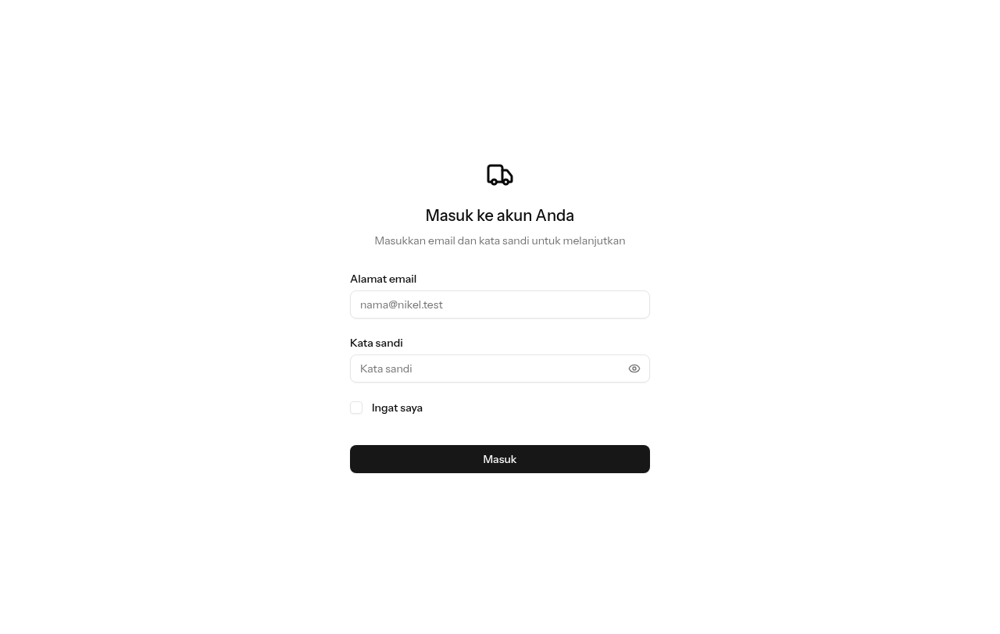                      | 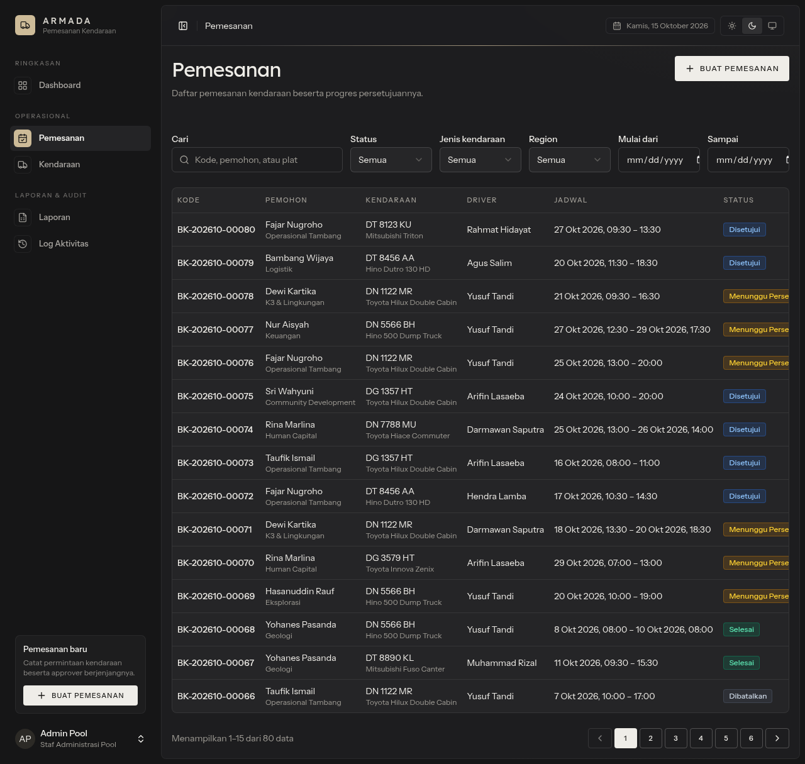     |
| 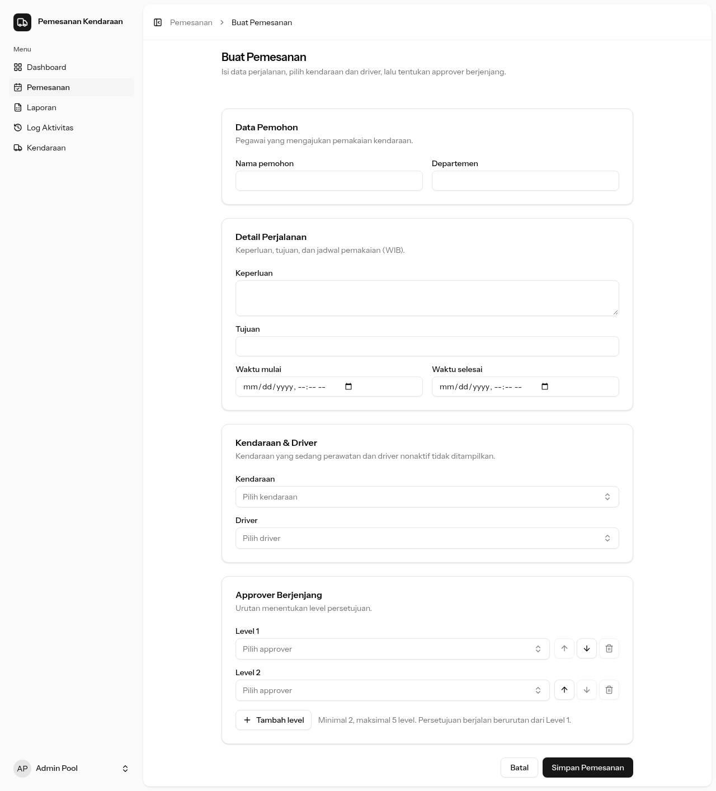    | 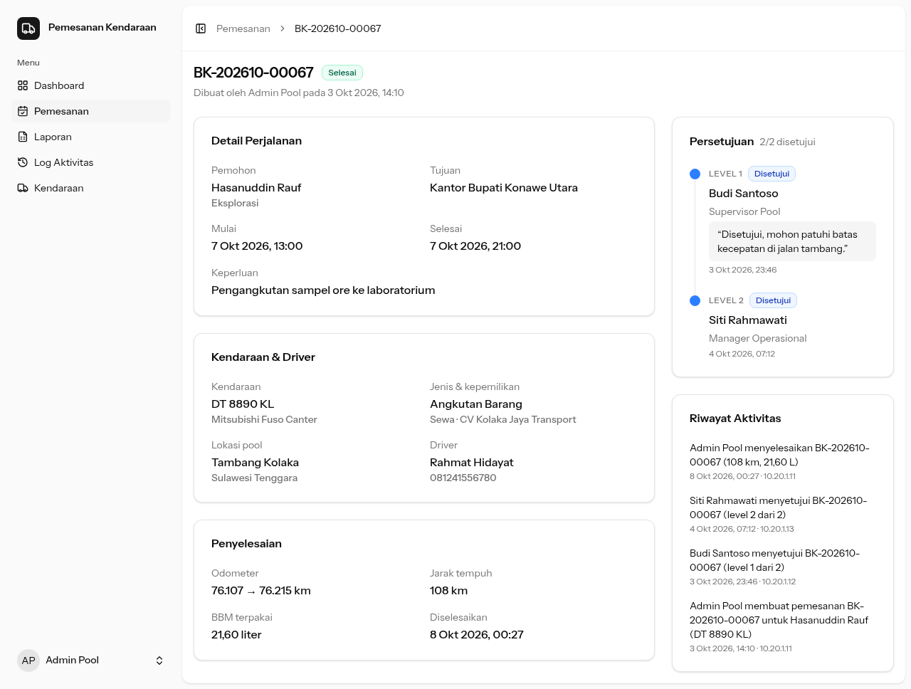     |
| 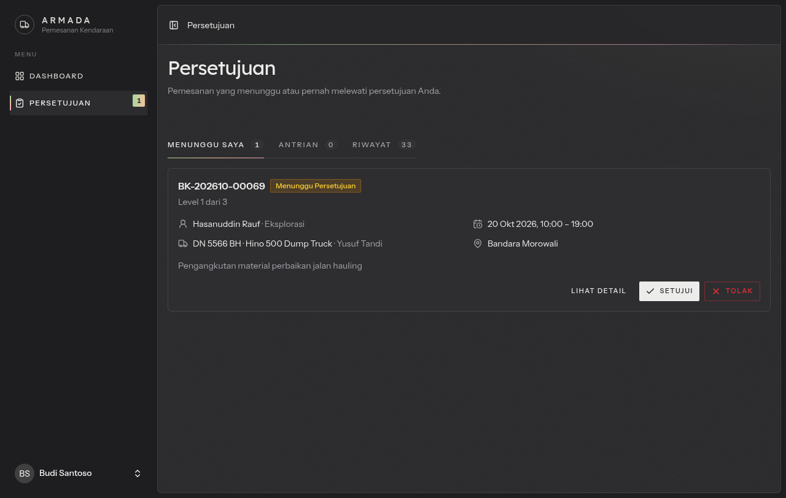 | 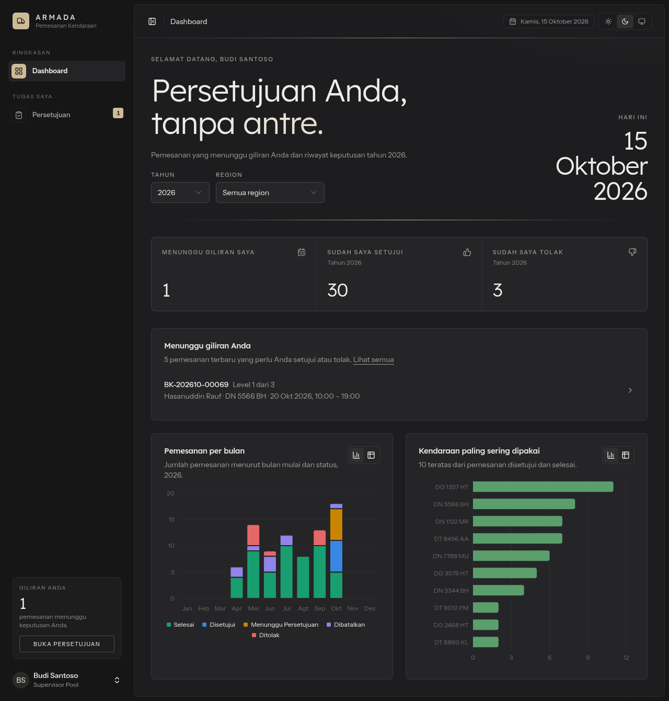 |
| 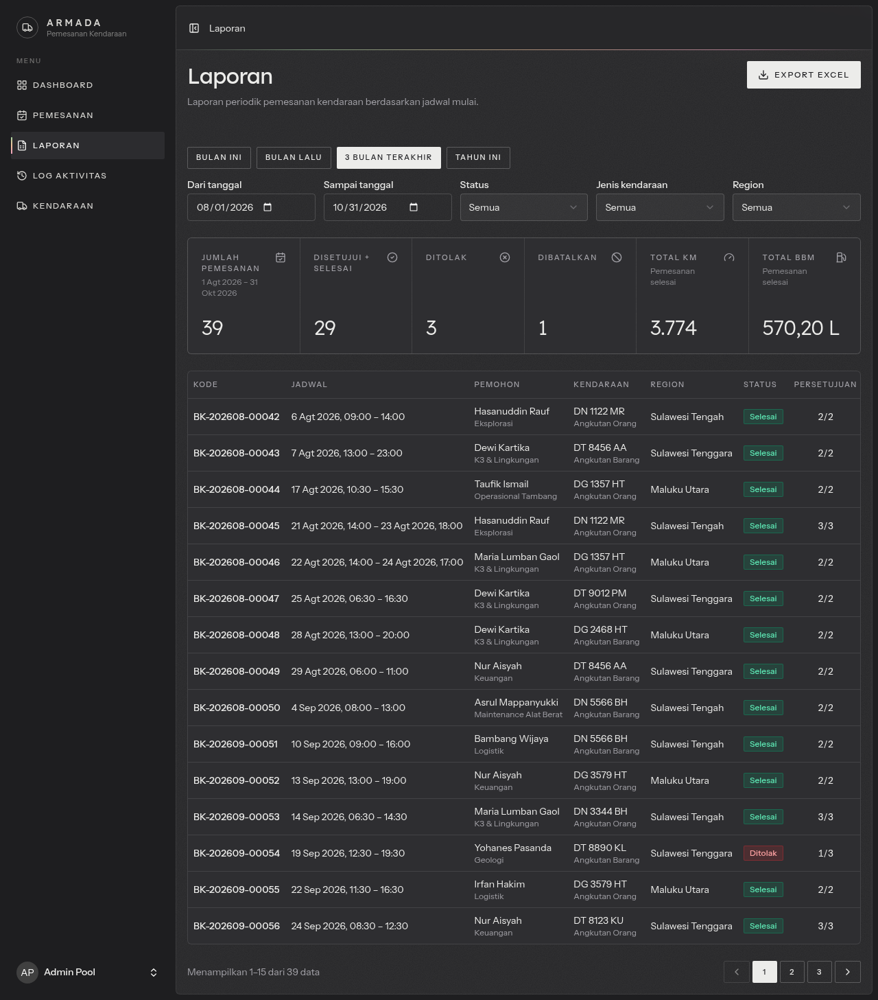                  | 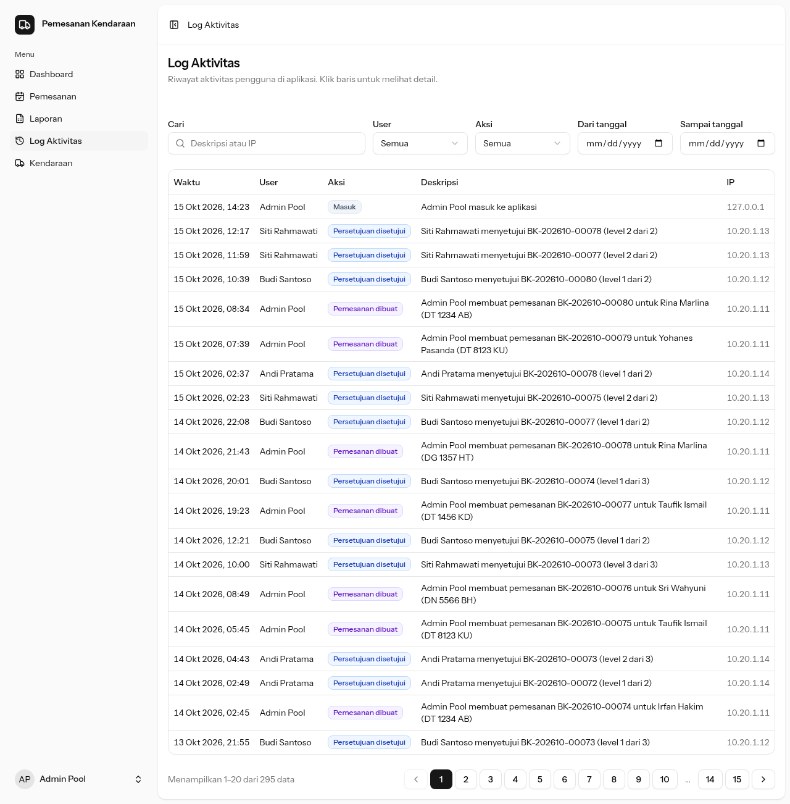           |
| 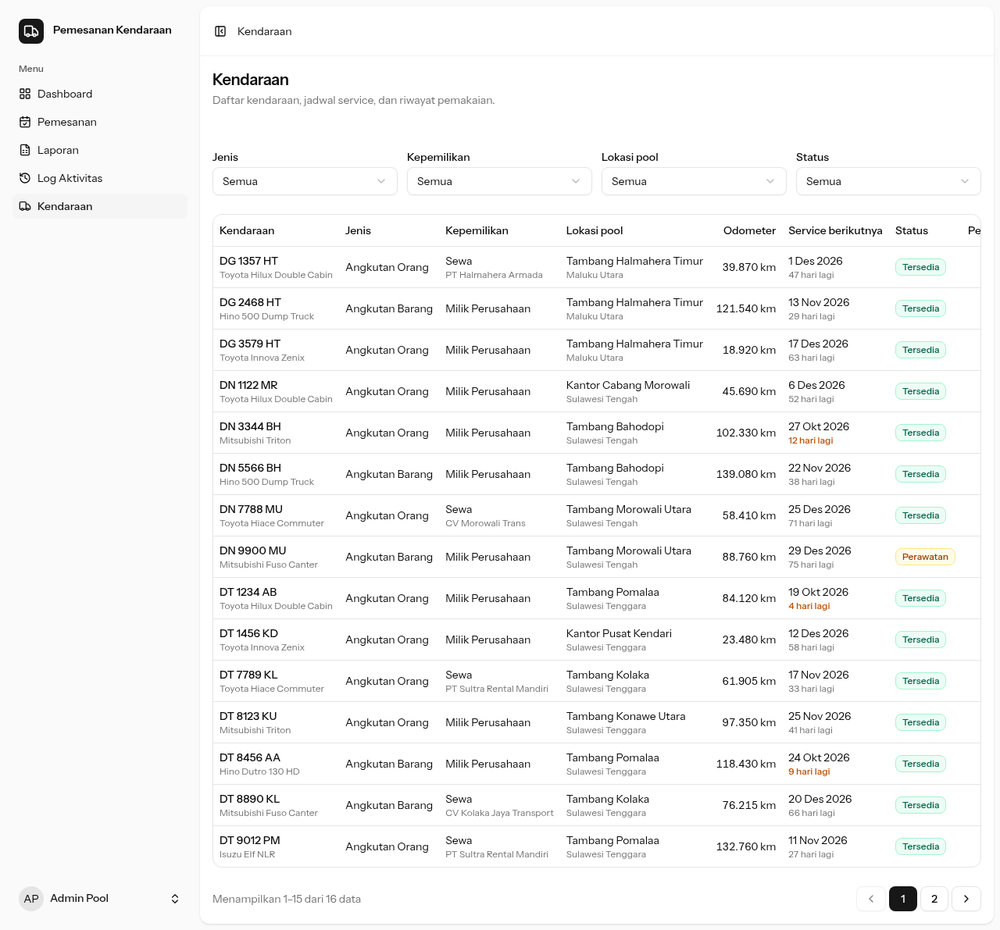              | 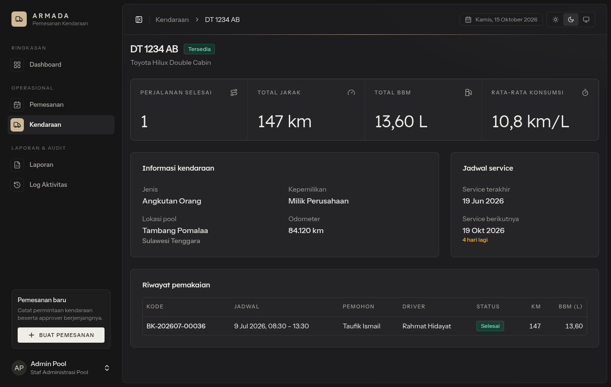     |

Tampilan mobile (375px): [dashboard](docs/screenshots/12-mobile-dashboard.png).

## Catatan teknis

- **Starter kit:** project dimulai dari Laravel _blank_ React starter kit. Layout sidebar dan komponen shadcn/ui dipulihkan dari starter kit React resmi. Login ditulis sendiri tanpa Fortify, sehingga tidak ada route, halaman, maupun tautan registrasi.
- **Export Excel:** memakai `maatwebsite/excel` 4.0.4, versi yang mendukung Laravel 13. Versi ini bergantung pada PhpSpreadsheet 5, yang mewajibkan ekstensi PHP `gd`.
- **Waktu:** zona waktu aplikasi `Asia/Jakarta` dan locale `id`. Tanggal di UI selalu tampil dalam WIB, mis. `14 Okt 2026, 09:00`, terlepas dari zona waktu browser.
- **Warna grafik:** memakai palet yang sudah divalidasi untuk buta warna dan kontras di mode terang dan gelap. Karena itu warna "Dibatalkan" di grafik berbeda dari badge abu-abunya; warna abu-abu tidak lolos validasi sebagai warna kategori.
