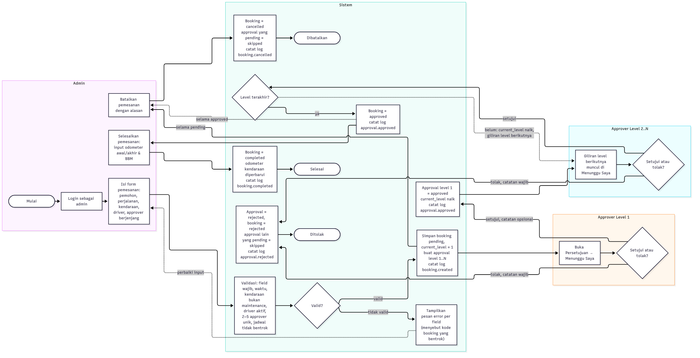
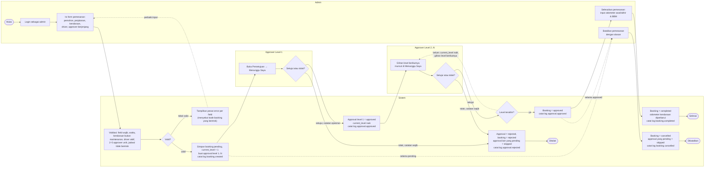

# Activity Diagram — Pemesanan Kendaraan

Alur pemesanan dari input admin sampai pemesanan selesai, termasuk penolakan dan pembatalan. Setiap _subgraph_ adalah satu swimlane (kiri ke kanan: Admin, Sistem, Approver Level 1, Approver Level 2..N); panah putus-putus menandai perulangan dan cabang opsional.

## Langkah

1. **Admin** login, lalu mengisi form pemesanan: data pemohon, detail perjalanan, kendaraan, driver, dan 2–5 approver yang urutannya menjadi level persetujuan.
2. **Sistem** memvalidasi input (`StoreBookingRequest`) dan memeriksa bentrok jadwal kendaraan dan driver (`BookingService`) di dalam transaksi. Jika gagal, form kembali dengan pesan error per field; pesan bentrok menyebut kode booking yang bentrok.
3. Jika valid, sistem menyimpan booking berstatus `pending` dengan `current_level = 1`, membuat approval level 1..N berstatus `pending`, dan mencatat log `booking.created`.
4. **Approver level 1** melihat pemesanan di tab _Menunggu Saya_. Approval hanya bisa diproses oleh pemiliknya, saat approval dan booking masih `pending`, dan levelnya sama dengan `current_level` (dicek di `ApprovalPolicy`, lalu dicek ulang setelah `lockForUpdate` di `ApprovalService`).
    - **Setujui** → approval `approved`, `current_level` naik, giliran berpindah ke level berikutnya.
    - **Tolak** (catatan wajib) → booking `rejected` dan approval lain yang masih `pending` menjadi `skipped`.
5. **Approver level 2..N** mengulang langkah yang sama. Persetujuan di level terakhir membuat booking `approved`.
6. **Admin** menyelesaikan booking `approved` dengan mengisi odometer awal (bawaan: odometer kendaraan saat ini), odometer akhir (≥ odometer awal), dan BBM terpakai (> 0 liter). Booking menjadi `completed` dan odometer kendaraan diperbarui.
7. **Cabang pembatalan:** selama booking masih `pending` atau sudah `approved`, admin dapat membatalkannya dengan alasan wajib. Booking menjadi `cancelled` dan approval yang masih `pending` menjadi `skipped`.

Setiap langkah yang mengubah data tercatat di tabel `activity_logs` dan di `storage/logs/activity-*.log`.
