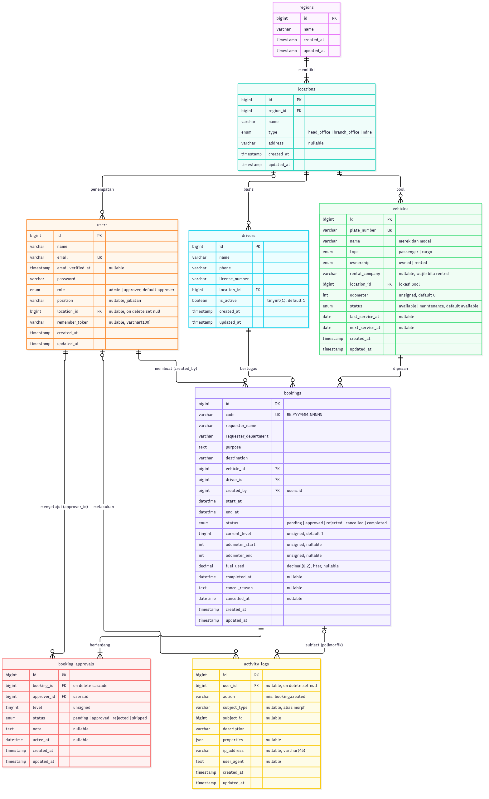
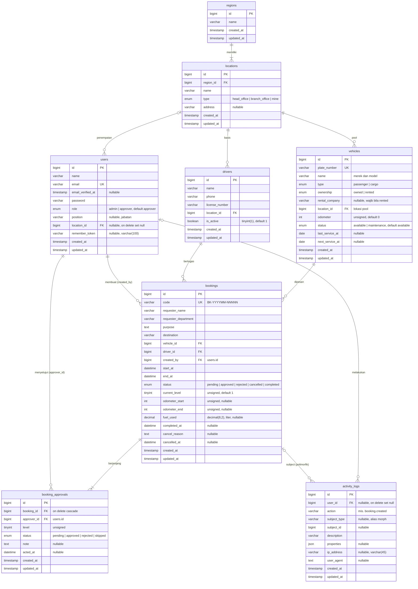

# Physical Data Model — Pemesanan Kendaraan

Model data fisik fitur pemesanan kendaraan. Tipe kolom mengikuti skema MySQL/MariaDB yang dihasilkan migration (`bigint` = `bigint unsigned`, `varchar` = `varchar(255)` kecuali disebut lain). Semua tabel memakai `id` auto increment dan kolom `created_at`/`updated_at`.

## Penjelasan tabel

| Tabel               | Isi                                                                                                                                                                                                               | Kunci & indeks                                                                                                                                                                              |
| ------------------- | ----------------------------------------------------------------------------------------------------------------------------------------------------------------------------------------------------------------- | ------------------------------------------------------------------------------------------------------------------------------------------------------------------------------------------- |
| `regions`           | Wilayah operasional: Sulawesi Tenggara, Sulawesi Tengah, Maluku Utara.                                                                                                                                            | PK `id`.                                                                                                                                                                                    |
| `locations`         | Kantor pusat, kantor cabang, dan tambang di setiap region. `type` membedakan ketiganya.                                                                                                                           | FK `region_id` → `regions`.                                                                                                                                                                 |
| `users`             | Akun aplikasi. `role` membedakan admin (pool) dan approver; `position` adalah jabatan yang tampil di daftar approver.                                                                                             | Unik `email`; FK `location_id` → `locations` (nullable, _set null_).                                                                                                                        |
| `drivers`           | Pengemudi beserta lokasi basisnya. Hanya driver `is_active` yang bisa dipilih saat memesan.                                                                                                                       | FK `location_id` → `locations`.                                                                                                                                                             |
| `vehicles`          | Kendaraan angkutan orang/barang, milik perusahaan atau sewa. `odometer` diperbarui saat pemesanan diselesaikan; `next_service_at` dipakai untuk peringatan service.                                               | Unik `plate_number`; FK `location_id` → `locations`.                                                                                                                                        |
| `bookings`          | Pemesanan kendaraan. `current_level` menunjuk level approval yang sedang menunggu giliran; kolom odometer, BBM, dan `completed_at` terisi saat selesai; `cancel_reason` dan `cancelled_at` saat dibatalkan.       | Unik `code`; FK `vehicle_id`, `driver_id`, `created_by` (→ `users`); indeks `(vehicle_id, start_at, end_at)` dan `(driver_id, start_at, end_at)` untuk cek bentrok jadwal; indeks `status`. |
| `booking_approvals` | Satu baris per level persetujuan. Level 1..N dibuat bersamaan dengan booking; urutannya adalah urutan approver di form.                                                                                           | FK `booking_id` (_cascade_), `approver_id` (→ `users`); unik `(booking_id, level)` dan `(booking_id, approver_id)` sehingga satu approver tidak muncul dua kali.                            |
| `activity_logs`     | Log aplikasi untuk setiap proses: login/logout/gagal login, pembuatan, persetujuan, penolakan, pembatalan, penyelesaian pemesanan, dan export laporan. `subject_type` memakai alias morph (`booking`, `user`, …). | FK `user_id` (→ `users`, _set null_); indeks `(subject_type, subject_id)`, `action`, `created_at`.                                                                                          |

## Aturan integritas di level aplikasi

- Jadwal kendaraan dan driver tidak boleh beririsan dengan booking lain berstatus `pending`/`approved` (`start_at < end_baru` dan `end_at > start_baru`). Dicek di `BookingService` di dalam transaksi setelah baris kendaraan dan driver dikunci (`lockForUpdate`).
- Status approval selalu konsisten dengan status booking: booking `approved`/`completed` berarti semua approval `approved`; booking `rejected` berarti satu approval `rejected` dan sisanya `skipped`; booking `cancelled` membuat approval yang masih `pending` menjadi `skipped`.
- `bookings.code` dibentuk dari bulan pembuatan dan `id` (`BK-202610-00012`) di dalam transaksi yang sama dengan insert.

## Tabel bawaan Laravel

`password_reset_tokens`, `sessions`, `cache`, `cache_locks`, `jobs`, `job_batches`, `failed_jobs`, dan `migrations` berasal dari migration bawaan Laravel dan tidak termasuk model data pemesanan.
